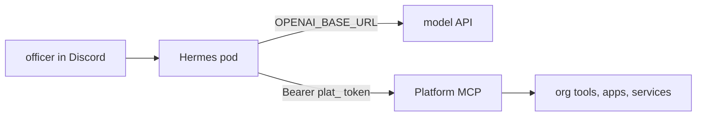

# Hermes

[Hermes Agent](https://github.com/NousResearch/hermes-agent) is an open-source agent from Nous Research. Here it runs as an agent for officers in the org's Discord, and does Platform work through Platform MCP: triage errors, deploy apps, look up members, search. The image is `nousresearch/hermes-agent`, pulled through `mirror.gcr.io`. The suggested tag is `v0.23.0`.



> **Caution:** Hermes can run commands in its pod and call every tool its Platform token allows. Give the token only the scopes it needs, and let only officer roles use the bot.

- All Hermes state (config, memory, sessions, skills) lives in `/opt/data` on a RunPod network volume. Make the volume before you create the app. Without it, a deploy erases everything.
- The pod runs `hermes gateway run`. Port 8642 is the Hermes API and its `/health` check. Every route but `/health` needs the Hermes API key.
- Use a Discord app of its own for Hermes. Two processes on one bot token fight over the gateway session.
- In the Discord developer portal, turn on the Message Content and Server Members intents.

## Inputs

| Input | Sets |
| --- | --- |
| Discord bot token | `DISCORD_BOT_TOKEN`, as the org secret `app_<name>_discord_bot_token` |
| Discord role IDs | `DISCORD_ALLOWED_ROLES`, comma separated. Only members with one of these roles can use the bot |
| Model API key | `OPENAI_API_KEY`, as an org secret |
| Model API base URL | `OPENAI_BASE_URL`, any OpenAI compatible API, such as `https://openrouter.ai/api/v1` |
| Model name | `HERMES_INFERENCE_MODEL`. Hermes needs a model with 64K context or more and tool calls |
| Platform token | `MCP_PLATFORM_API_KEY`, as an org secret. Make it on the Connections page, For services, kind agent. Add `discord:read` so it can read the server |
| Platform MCP URL | `PLATFORM_MCP_URL`, such as `https://<host>/mcp` |
| Hermes API key | `API_SERVER_KEY`, as an org secret. Make one with `openssl rand -hex 32` |
| Network volume ID | The volume at `/opt/data` |
| Data center of the volume | `dataCenterIds` |

## Connect Platform MCP and its skills

Hermes reads MCP servers from `config.yaml`, not from env. Do this once after the first deploy, in a shell on the pod (RunPod, the pod, Connect):

```bash
hermes mcp add platform --url "$PLATFORM_MCP_URL" --auth header
hermes skills tap add asusoda/platform
```

`--auth header` finds `MCP_PLATFORM_API_KEY` in the env and writes this to `/opt/data/config.yaml`. The token stays in the env, never in the file:

```yaml
mcp_servers:
  platform:
    url: "https://<host>/mcp"
    headers:
      Authorization: "Bearer ${MCP_PLATFORM_API_KEY}"
```

The tap adds the Platform MCP skills in [skills/](../../skills/README.md). Install `platform-mcp` first. Hermes can also read them over MCP with the `guide` tool. Then restart the app on the Hosting page.

## Updates

Deploy a new tag from the Hosting page. Tags are at [Docker Hub](https://hub.docker.com/r/nousresearch/hermes-agent/tags). The volume keeps config, memory and skills across deploys.
