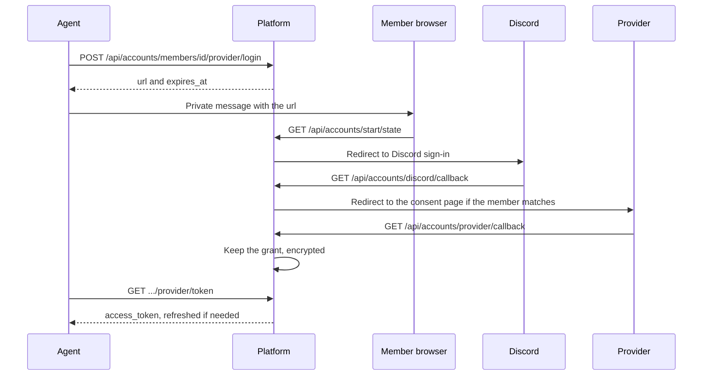

# Accounts

Members connect their Google Calendar one time, and agents use them for the member. Platform keeps the OAuth grants, encrypted with `SECRETS_KEY`, and refreshes the access tokens. Agents keep no provider tokens.

## Sign-in

1. The agent calls `POST /api/accounts/members/<discord_id>/<provider>/login` and sends the returned `url` to the member in a private message. The link works one time, for 10 minutes.
2. The link signs the browser in to Discord. The sign-in continues only if that Discord account is the member that the link is for. Thus a forwarded link cannot connect a different account.
3. The browser goes to the provider's consent page, then back to `/api/accounts/<provider>/callback` in the same browser session. Platform gets the grant and keeps it.

## Routes

Agent routes are under `/api/accounts/members/<discord_id>` and need a machine token. The org is the org of the token.

| Route | Scope | Does |
| --- | --- | --- |
| `GET /` | `accounts:link` | Connected providers, scopes and expiry. No tokens |
| `POST /<provider>/login` | `accounts:link` | Starts a sign-in. Returns `url` and `expires_at` |
| `DELETE /<provider>` | `accounts:link` | Removes the grant |
| `GET /<provider>/token` | `accounts:token` | `access_token`, `scopes`, `expires_at`. Refreshes the token if it expires in less than one minute. Writes to the audit log |

`token` returns these errors:

- 404: the member has no connection.
- 409: the member must connect again. The grant has no refresh token, or the provider answered the refresh with `invalid_grant`. In that case Platform deletes the grant.
- 502: the provider does not answer, or refuses the refresh with another error. Platform keeps the grant.
- 503: `SECRETS_KEY` is not set or cannot decrypt the grant.

Other routes:

- `GET /api/accounts/providers`: the providers that are on.
- `GET /api/accounts/<org>/me` and `DELETE /api/accounts/<org>/me/<provider>`: a member signed in with Discord lists and removes their own connections.

## Settings

| Variable | Does |
| --- | --- |
| `ACCOUNTS_BASE_URL` | The public URL of the API. Required, because providers send the browser back to it |
| `ACCOUNTS_<NAME>_CLIENT_ID`, `ACCOUNTS_<NAME>_CLIENT_SECRET` | Turn on a provider. Names: `GOOGLE` |
| `ACCOUNTS_<NAME>_SCOPES` | Space-separated. Default: Google calendar events read |
| `ACCOUNTS_<NAME>_AUTHORIZE_URL`, `ACCOUNTS_<NAME>_TOKEN_URL` | Other provider URLs |

Add these redirect URLs:

- In the Discord app of `CLIENT_ID`: `<ACCOUNTS_BASE_URL>/api/accounts/discord/callback`.
- In each provider app: `<ACCOUNTS_BASE_URL>/api/accounts/<provider>/callback`.

The provider apps are for the whole deployment.

The `accounts.prune` job runs each hour and deletes expired sign-ins.
