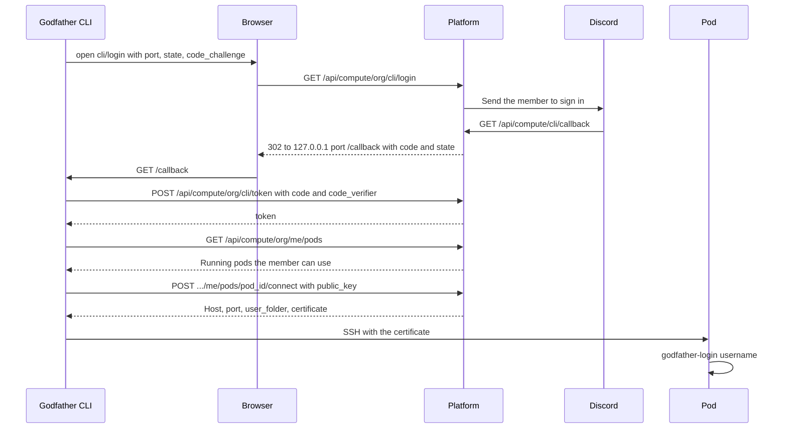

# Godfather

Godfather is a module: GPU and CPU pods on an org's own hosting provider account that members connect to over SSH with a Godfather CLI. Apps are a different layer: the org's own deployments on the Hosting page. A pod is not an app. RunPod is the only provider that Godfather can use: its pods need SSH. The reference CLI is `godfather` (`pip install godfather-cli`). Officers create pods and select who can use them. A member gets a certificate for their own SSH key that works on one pod for 12 hours.

## Setup

1. Connect RunPod on the Integrations tab of the dashboard Explore page. This saves the org secret `runpod_api_key`. The runpod module uses the same key. `SECRETS_KEY` must be set.
2. Add the `godfather` module on Explore for the org.
3. Optional: set these in the server's `.env`.
   - `GODFATHER_CLI_NAME`: the CLI name in sign-in pages and errors. Default `godfather`. The old name `COMPUTE_CLI_NAME` still works.
   - `GODFATHER_POD_IMAGE`: the deployment default pod image. The old name `COMPUTE_POD_IMAGE` still works. Default `ghcr.io/theaisocietyasu/godfather-base:latest`.
   - `GODFATHER_MIN_IMAGE_VERSION`: the lowest godfather-base version Platform creates pods from and connects members to. Default `2.2.0`, the first version with user isolation. Empty turns the image check off; use it only to roll back.
4. Optional: set the org's own default pod image under Godfather > Settings on the dashboard (`PUT /api/compute/<org>/settings` with `{"pod_image": "..."}`, null to clear). A pod gets the image of its create body, else the org default, else `GODFATHER_POD_IMAGE`.

The first pod makes two ed25519 key pairs for the org in `compute_keys`. `SECRETS_KEY` encrypts the private keys.

- `backend`: its public key goes into root's `authorized_keys` on each pod.
- `user_ca`: pods trust it through `TrustedUserCAKeys`. It signs member and officer certificates.

The pod image must do this setup. It reads `GODFATHER_SSH_PUBLIC_KEY`, `GODFATHER_SSH_CA_PUBLIC_KEY` and `GODFATHER_SETUP` from its env. It accepts certificates with the principal `gf-<pod_id>`. It has `/usr/local/bin/godfather-login`. These names do not change with `GODFATHER_CLI_NAME`.

### Image check

Platform creates a pod only from godfather-base, or an image built `FROM` it, at `GODFATHER_MIN_IMAGE_VERSION` or later. It reads the label `com.ais-asu.godfather.base-version` from the registry with an anonymous token, so the image must be public. A create or a settings save with another image answers 422 and creates nothing. Platform sends RunPod the image by digest (`repo@sha256:...`), because a tag such as `latest` moves and RunPod does not report the digest a pod runs. The pod keeps `image_digest` and `image_version`.

A pod with no `image_version`, or one below the minimum, shows "Old image" on the Godfather page. Nobody can connect to it (409) until an officer recreates it. Recreate (`{"action": "recreate"}`) creates a new pod from the current default image with the same name, hardware, sharing, owner and sessions, then deletes the old pod and its disk. Env values are not stored, so the new pod has none; the answer lists the names in `env_not_copied`. Pod admin starts off.

## Officer routes

All routes are under `/api/compute/<org>` and need an officer of the org. The prefix keeps the old module name `compute`, because the Godfather CLI calls it.

| Route | Does |
| --- | --- |
| `GET /pods` | Pods made here, with `provider` and the live status from the provider |
| `POST /pods` | Creates a pod. Body below. 201 |
| `GET /pods/<pod_id>` | One pod |
| `PUT /pods/<pod_id>` | `{"is_public": true}`, `{"allowed_users": ["<discord id>", ...]}`, or both |
| `GET /members?q=&role=&limit=` | Server members for `allowed_users`, sorted by name, bots left out: `members` (`id`, `name`, `username`, `avatar`, `roles`) and `total`. `q` searches usernames and server nicknames that start with it. Without `q` the whole member list is read, which needs the Server Members intent on the bot. `role` keeps the holders of one role. `limit` is 1 to 500, default 50 |
| `GET /gpu-types?cloud=COMMUNITY` | RunPod GPU types offered on that cloud (`COMMUNITY` or `SECURE`), from RunPod's catalog with the org's key: `id`, `name`, `memory`, `price` (per hour for one GPU) and `availability` (`HIGH`, `MEDIUM`, `LOW` or `NONE`), in stock first, then cheapest. Cached for 60 seconds. The New pod form lists them and blocks types with `NONE` |
| `GET /members/roles` | Server roles to filter by, highest first, without the everyone role and roles that bots manage: `id`, `name`, `color` |
| `GET /members?ids=<id>,<id>` | The display names of up to 50 ids. 503 when Discord does not answer |
| `POST /pods/<pod_id>/action` | `{"action": "start" \| "stop" \| "restart" \| "terminate" \| "recreate"}`. `terminate` deletes the pod and its record. `recreate` answers `{"id", "replaced", "env_not_copied"}` |
| `PUT /pods/<pod_id>/admin` | `{"enabled": true}` turns pod admin on. Only the pod owner (`owner`, who created it) or the superadmin. Others get 403 |

A pod in `GET /pods` has `image`, `image_version`, `image_current`, `admin_enabled`, `admin_enabled_by`, `owner` and `can_change_admin` (the caller may change pod admin).

All fields of the create body are optional. `provider` names the hosting provider, default `runpod`. An unknown name answers 400. Platform sends the other fields to the RunPod v2 API. A GPU pod gets a volume when `volume_in_gb` is 10 or more. A CPU pod has no volume, and `vcpu_count` is a power of two. When RunPod refuses the request, the route answers 400 with RunPod's reason. When RunPod fails, it answers 424.

```json
{
  "provider": "runpod",
  "name": "workshop",
  "image_name": "ghcr.io/theaisocietyasu/godfather-base:latest",
  "gpu_type_id": "NVIDIA RTX A4000",
  "use_cpu_only": false,
  "cpu_flavor": "cpu3c",
  "vcpu_count": 2,
  "cloud_type": "COMMUNITY",
  "volume_in_gb": 0,
  "container_disk_in_gb": 20,
  "volume_mount_path": "/workspace",
  "env": {"HF_HOME": "/workspace/hf"},
  "is_public": false,
  "allowed_users": []
}
```

## Member page

`/godfather/<org>` on the dashboard is open to members. After a Discord sign-in (`GET /api/auth/store_login?org=<org>&page=godfather`), it shows the member's pods with their state, the next sessions, the last 10 connections and the CLI commands. The Godfather page links to it with Member page, for officers to share.

## Member routes

These routes need a Discord session, or the CLI token as `Authorization: Bearer plat_...`. Each request checks that the caller is a member of the org's server.

| Route | Does |
| --- | --- |
| `GET /api/compute/<org>/me` | The member page: `organization`, `pods` the member may connect to in any state (`id`, `name`, `status`, `is_public`, `image_current`; `status` is `UNKNOWN` when the provider does not answer), `sessions` as in `me/sessions`, the member's last 10 `connections` (`pod_id`, `pod_name`, `is_admin`, `created_at`) and `cli` (`package`, `install`) |
| `GET /api/compute/<org>/me/pods` | Running pods that are public or that list the member in `allowed_users` |
| `POST /api/compute/<org>/me/pods/<pod_id>/connect` | `{"public_key": "ssh-ed25519 ...", "admin": false}`. Returns host, port, `user_folder`, `is_admin` and a certificate |
| `GET /api/compute/<org>/me/sessions` | Up to 20 upcoming sessions of the pods the member may connect to, running or not: `pod_id`, `pod_name`, `title`, `start_at`, `stop_at` and `pod_starts_at` (10 minutes before `start_at`) |

A member certificate has the principal `gf-<pod_id>` and forces `/usr/local/bin/godfather-login <username>`, which puts the member in their own account and folder. It is valid from 5 minutes ago to 12 hours from now. Officers get a member certificate too, on any pod of the org.

Root is a choice. An officer gets a root certificate only with `"admin": true` (`godfather connect --admin`) on a pod whose owner turned on pod admin. A member who asks gets 403, and so does an officer on a pod without pod admin. A root certificate has no forced command, allows agent forwarding, ends in `:admin` in its key id, and is valid for 1 hour. Each one sends the `pod.root_access` event, so it shows on Activity. Turning pod admin off stops new root certificates; issued ones expire within the hour.

Both kinds allow port forwarding, which VS Code Remote-SSH needs. Remote forwards stay off on the pod. The audit log records each connect, and the `compute_connections` table keeps it for the pod's member list.

## Who is on a pod

Officers see who can connect to a pod, who connected and who is connected now. On the dashboard, open a pod's Members from its row on the Godfather page.

| Route | Does |
| --- | --- |
| `GET .../pods/<pod_id>/members` | `access`: `is_public` and the `allowed` members (`discord_id`, `name`). `recent`: the last 100 certificates for the pod, newest first (`discord_id`, `name`, `username`, `is_admin`, `created_at`) |
| `GET .../pods/<pod_id>/members/connected` | The live SSH sessions on the pod: `state` (`known` or `unknown`), `reason`, and `sessions` (`username`, `is_admin`, `seconds`, `discord_id`, `name`) |

Names come from the org's Discord server, for at most 50 members in each request. Other names are null. `connect` writes one `compute_connections` row for each certificate. A new row deletes the org's rows older than 90 days. Terminate deletes the pod's rows.

The connected route opens SSH to the pod as root with the `backend` key, with a 5 second limit. It runs `ps` and finds the `su - godfather_<username>` process of each member session and the `/etc/godfather/admin.bashrc` shell of each officer session, which has `GODFATHER_USER` in its environment. It maps a username to the member who last got a certificate with it for the pod. The answer is always 200. The state is `unknown`, with a reason, when the pod is stopped, SSH fails, or the pod has no `/usr/local/bin/godfather-login`. A root SSH login that does not go through `godfather-login` is not shown.

## CLI sign-in

1. `<cli> auth` opens `GET /api/compute/<org>/cli/login`, which sends the member to Discord.
2. Discord returns to `GET /api/compute/cli/callback`. If the member is in the org's server and Godfather is on, Platform gives the CLI a token.
3. The CLI sends the token on the member routes.

In step 2 the token reaches the CLI in one of two ways:

- **Browser return (CLI 2.2.0 and later).** The CLI listens on `127.0.0.1` and adds `port`, `state`, `code_challenge` and `code_challenge_method=S256` to `cli/login`. The callback sends the browser to `http://127.0.0.1:<port>/callback` with a one-time `code` and the CLI's `state`. The CLI posts `{"code", "code_verifier"}` to `POST /api/compute/<org>/cli/token` and gets `{"token", "expires_days"}`. A code works once, for 2 minutes, and only with the verifier of its challenge (PKCE, RFC 7636). A wrong verifier uses up the code. The host is always `127.0.0.1`, so the redirect cannot send the code to another machine. Send all four parameters or none: a partial or bad set answers 400.
- **Paste.** Without the parameters the page shows the token one time, and the member pastes it into the CLI. CLI 2.1.0 and older, `<cli> auth --paste`, and a CLI that cannot open a port use this.

`POST .../cli/token` with an empty body answers 400. The CLI uses it to tell a server with browser return from an older one (404).



The token is a machine token of kind `cli` with the scope `godfather:connect`, for the member's Discord id and the org. It is valid for 90 days. A new sign-in revokes the member's previous CLI token. The audit log records each token. Codes live in `compute_cli_codes` as SHA-256 hashes, and each new code deletes the expired ones.

The CLI sign-in needs `ACCOUNTS_BASE_URL`, `CLIENT_ID` and `CLIENT_SECRET` on the server, and `<ACCOUNTS_BASE_URL>/api/compute/cli/callback` as a redirect of the Discord app.

## Sessions

A session is a time when a pod must run, such as a workshop. The `godfather.schedule` job runs every 5 minutes. It starts a pod 10 minutes before a session starts, and stops it when the session ends, unless a different session on the pod is still open. A pod that was already running when its session started is also stopped after it. The job does not touch pods with no sessions. A stopped pod costs only its disk, so one pod can serve a series of workshops.

| Route | Does |
| --- | --- |
| `GET .../pods/<pod_id>/sessions` | All sessions of the pod |
| `POST .../pods/<pod_id>/sessions` | `{"title", "start_at", "stop_at"}`, ISO 8601 with a time zone, 24 hours or less. 201 |
| `DELETE .../pods/<pod_id>/sessions/<id>` | Removes a session. If the pod started for it, the next run stops it |

## File manager

These officer routes work on the files of a running pod over SFTP, as root with the org's `backend` key. Paths are absolute. `...` is `/api/compute/<org>`.

| Route | Body | Does |
| --- | --- | --- |
| `GET .../pods/<pod_id>/files?path=/workspace` | | Folder entries, folders first |
| `POST .../files/read` | `{"path"}` | Text content, up to 1 MB |
| `POST .../files/write` | `{"path", "content"}` | Replaces a file with text, up to 1 MB |
| `POST .../files/download` | `{"path"}` | The file as an attachment, up to 100 MB |
| `POST .../files/upload` | multipart `file`, form `path` (folder) | Saves a file, up to 100 MB |
| `POST .../files/mkdir` | `{"path"}` | Makes a folder |
| `POST .../files/rename` | `{"old_path", "new_path"}` | Moves or renames |
| `POST .../files/delete` | `{"path"}` | Deletes a file, or a folder and its contents. Refuses `/`, `/workspace`, `/root` and `/home` |

A stopped pod returns 409. A failed SSH connection returns 502. Platform does not check pod host keys, because RunPod does not publish them.

Officers manage pods on the dashboard Godfather page, `/<org>/godfather`. From it they create, start, stop, restart, terminate and recreate pods, turn pod admin on or off, change who can connect, add and remove sessions, and work with the files of a running pod.

## Adding a hosting provider

A hosting provider is the cloud that Godfather pods and apps run on. `core/hosting.py` has the interface and the registry. The providers are RunPod (`core/integrations/runpod.py`) and This server (`core/integrations/server.py`); Godfather refuses a provider whose `godfather` is false. `GET /api/dashboard/<org>/hosting/providers` lists the providers with `configured` for the org, and the dashboard shows them in its Provider selects.

1. Write a client with the `HostingClient` calls: `list_pods`, `get_pod`, `create_pod`, `update_pod`, `start_pod`, `stop_pod` and `delete_pod`. Raise a `HostingError` subclass with the provider's HTTP status when a call fails. A missing pod gives `None` from `get_pod`.
2. Write a provider class with `name`, `title` and `integration`, and the methods `configured`, `client`, `status`, `machine`, `ssh_address` and `proxy_url`. `status` returns `RUNNING` for a running pod and `GONE` for `None`.
3. Register an integration for the provider's keys in `core/integrations/registry.py`, so officers connect it on Integrations.
4. Call `hosting.register()` in the module, and add the module to `PROVIDER_MODULES` in `core/hosting.py`.
5. The create bodies of Godfather pods (`pod_request` in `modules/godfather/service.py`) and of app manifests follow the RunPod v2 API. Map them to the new provider's API in its client, or give the provider its own request builder.
6. Show the provider's own fields in `dashboard/src/pages/godfather/new-pod.tsx` when it is selected, as the RunPod hardware fields are.

The `provider` column of `compute_pods` and `runpod_apps` keeps the name, so a rename breaks existing rows. The module name `runpod` stays, and the tables of `godfather` keep their `compute_` names. A later change can rename `modules/runpod` to `modules/hosting`.

## Limits

- Members connect with the Godfather CLI. The member page at `/godfather/<org>` on the dashboard shows their pods, sessions and connections; it does not connect.
- The RunPod field names follow RunPod's REST API and are tested against a fake. Check them with a real key before you use the module in production.
