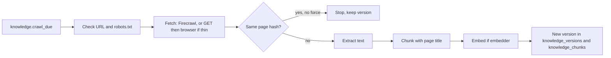
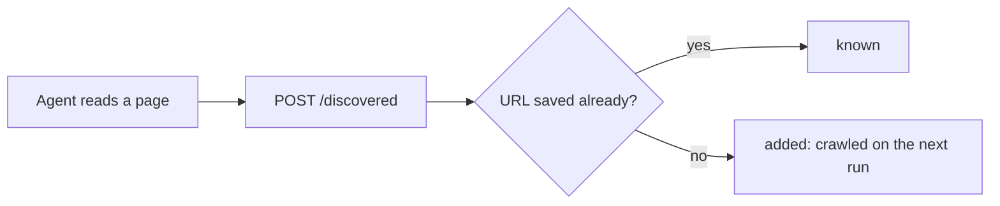
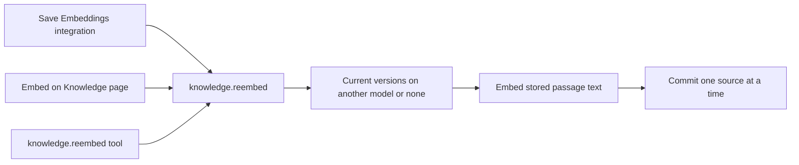
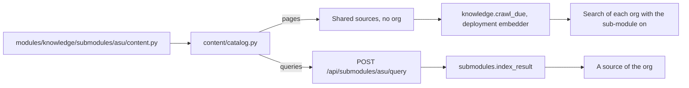
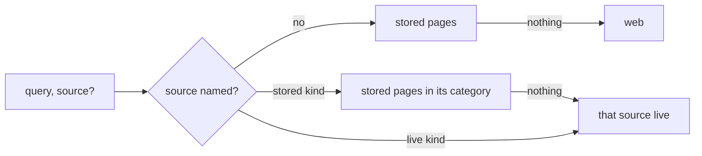

# Knowledge

Sources of text that agents search, such as web pages, handbooks and FAQs. A client writes a source as chunks, an officer uploads a document, or Platform crawls a URL on a schedule.

## Access

- Writers and searchers use a machine token with `knowledge:write`, `knowledge:read` or both. The org is the org of the token.
- Search covers the caller's org and the public sources. A public source shows in the results of every org. Thus only publishers can write one. The superadmin marks publishers on the Publishers page of the superadmin space (`/admin/publishers`, `PUT /api/superadmin/publishers/<org_id>` with `{"publisher": true}`). Orgs in `KNOWLEDGE_PUBLISHERS` (org prefixes, comma-separated) are publishers too.
- List, read and delete cover only the caller's org.
- Officers upload documents, manage crawls, change the search settings and test search on the Knowledge page of the dashboard, with no token.

## Routes

All routes are under `/api/knowledge`.

| Route | Scope | Does |
| --- | --- | --- |
| `GET /sources?category=` | read | The org's sources and their current version |
| `GET /sources/<key>` | read | One source |
| `PUT /sources/<key>` | write | Creates or replaces a source. 201 if the content changed, 200 if not |
| `DELETE /sources/<key>` | write | Deletes the source, its versions and its chunks |
| `POST /search` | read | Ranked passages. The audit log does not record searches |
| `PUT /crawls/<key>` | write | A crawled source: `url`, `category`, `fetch_every_hours` (1 to 720, default 24), `title`, `public`, `enabled` |
| `POST /crawls/run` | write | `{"key": ..., "force": false}`. Starts a crawl now. 202 |
| `POST /discovered` | discover | `{"url": ...}`. Saves a page an agent read. 201 added, 200 known. See [Pages agents read](#pages-agents-read) |

The key is the writer's fixed name for the source: letters, digits and `._:/-`, 255 characters or fewer.

```json
{
  "category": "library",
  "title": "Library hours",
  "url": "https://example.edu/library/hours",
  "public": false,
  "content_hash": "optional; computed from the chunks if missing",
  "embedding_model": "required if the chunks have embeddings",
  "chunks": [
    {"ordinal": 0, "content": "...", "embedding": [1024 numbers], "level": 0, "parent_ordinal": 2}
  ]
}
```

- A `PUT` replaces the whole source. If `content_hash` is the hash of the current version, only the title, URL, category and public flag change.
- `level` 0 is page text. Levels 1 and higher are summaries of the rows below them. `parent_ordinal` points from a row to its summary. A source has up to 5000 chunks of up to 20000 characters.
- All chunks have an `embedding` (1024 numbers), or none do. If none do and an embedder is set, Platform makes the embeddings. If there is no embedder, the source is text only.

The `POST /search` body has `query`, and optional `category`, `top_k` (1 to 50; the org's setting, default 8), `window` (0 to 5; the org's setting, default 0), and `embedding` with `embedding_model` to search with the caller's own vector. Each result has `chunk_id`, `source_key`, `title`, `url`, `category`, `public`, `content`, `score` and `fetched_at`. `dense` in the response shows if the vector search ran. The `knowledge.search` tool runs the same search.

## Crawls

The `knowledge.crawl_due` job runs every 10 minutes. It crawls up to `KNOWLEDGE_CRAWL_BATCH` sources that are due, with `KNOWLEDGE_CRAWL_GAP_SECONDS` between fetches to the same host. Each crawl does these steps:

1. Checks that the URL is http or https and resolves only to public addresses. It follows redirects one at a time and checks each one. Each connection goes to an address that passed the check, so a second DNS answer cannot change it. Thus a source cannot point Platform at its own network.
2. Reads robots.txt with `KNOWLEDGE_USER_AGENT` and skips pages that it does not allow.
3. Gets the page through the org's Firecrawl (Integrations tab of Explore, else `FIRECRAWL_URL`), else with a GET of up to 10 MB. Without Firecrawl, a page with less than `KNOWLEDGE_RENDER_THIN_CHARS` characters of text, or one that asks the reader to turn on JavaScript, is loaded again in the shared browser when `BROWSER_URL` is set and the org's `knowledge.renders_per_day` allows it. If the render fails, the GET page is kept.
4. Stops if the page hash did not change, unless `force` is set.
5. Removes navigation, headers, footers, forms and scripts. Splits the text into chunks of the org's passage size with the page title on each, makes the embeddings and replaces the source's version. The old version and its chunks are deleted.
6. Refuses the new text if it is less than half of the last version (when that was 500 characters or more), so a broken page cannot remove a good index. `force` accepts it.



A source's `crawl` field shows its schedule, `last_attempt_at` and `last_error`.

A page that starts to fail keeps its last chunks; the error shows on the source. Delete the source to remove them.

## Pages agents read

An agent such as Sparky sends the URL of each public page it reads to `POST /api/knowledge/discovered` with a `knowledge:discover` token. Platform saves the page as a crawled source with the key `read/<host>/<hash>`. The next crawl run fetches it, and it is fetched again every `KNOWLEDGE_DISCOVER_EVERY_HOURS`.



- The category is the one most used by the org's other sources on that host, else `asu` for an ASU host, else `web`.
- Delete a saved page like any other source. The `knowledge.discovered_per_day` limit caps new pages a day (200).

## Uploads

`POST /api/dashboard/<org>/knowledge/documents` takes a multipart form: `files` (1 to 20 files, 10 MB each, 25 MB together), `folder` (default `upload`), `category` (default `documents`) and `public`. Platform reads `.txt`, `.md`, `.markdown`, `.csv`, `.html`, `.htm`, `.pdf` and `.docx`. Each file becomes a source with the key `<folder>/<file name>`, in lower case. The same name again replaces the source; if the file and the passage size did not change, nothing is written. A file that fails does not stop the others. The response lists each file with its key, passage count and error.

A PDF must have a text layer. Platform does not read scanned pages.

## Read a source

`GET /api/dashboard/<org>/knowledge/sources/<key>` gives the full text of one source, one page at a time. An org reads its own sources and public sources. It cannot read the private sources of another org. If the org has no source with the key, the oldest public source with that key is used.

- `chunk`: a `chunk_id` from a search result. The source that holds this chunk is used. `focus` lists the page text rows the chunk covers, and the page starts near them.
- `offset`: the first page text row of the page. Give `next_offset` to read the next page.

The response has `source` (the fields of the sources list, plus `own` and `text_chars`), `passages` (`id`, `ordinal`, `text`, in order), `focus`, `offset`, `next_offset` (`null` at the end) and `total`. A page holds up to 500 rows or 200,000 characters. Summary rows are not in the text. The text that a row repeats from the end of the row before (`chunk_overlap`) is removed. The `knowledge.read_source` tool gives the same pages as one `text`.

On the Knowledge page, select a source or a search result to open its text at `/<org>/knowledge/sources/<key>`. A search result opens with its passage marked.

## Run log

Each crawl and upload adds a row to `knowledge_runs`: the source key, `crawl` or `upload`, the time, the duration, if the index changed, the passage count and the error. Platform keeps the last 500 rows of each org. `GET /api/dashboard/<org>/knowledge/runs?limit=&failed=1` reads them; the Activity page of the dashboard shows them in the Knowledge runs tab.

## Org settings

Each org sets these on the Knowledge page (`GET` and `PUT /api/dashboard/<org>/knowledge/settings`). They are kept in the org config under `knowledge`. `null` returns a setting to its default.

| Setting | Range | Default | Does |
| --- | --- | --- | --- |
| `chunk_chars` | 100 to 4000 | `KNOWLEDGE_CHUNK_CHARS`, 300 | Passage size for crawls and uploads |
| `chunk_overlap` | 0 to half of `chunk_chars` | 0 | Text repeated from the end of the passage before |
| `mode` | `hybrid`, `text`, `vector` | `hybrid` | Which searches run. Without an embedder, every mode uses text |
| `top_k` | 1 to 50 | 8 | Results when the caller sends no `top_k` |
| `window` | 0 to 5 | 0 | Neighbor rows when the caller sends no `window` |
| `max_distance` | 0.05 to 2 | `KNOWLEDGE_MAX_DISTANCE`, 0.6 | Vector results farther than this are dropped |
| `rrf_k` | 1 to 200 | 60 | The constant of reciprocal rank fusion |

A new passage size applies when a source is indexed again. `POST /api/dashboard/<org>/knowledge/reindex` starts the `knowledge.reindex` job, which crawls every crawled source of the org with `force`. Upload a document again to split it again.

## Embeddings

Platform embeds a source when it writes the source: a crawl, an upload or a `PUT`. Each version keeps the name of the model, and each passage keeps the text it was embedded from. Vector search uses only passages of the org's current model. A passage of another model, or with no vector, is found by text search only.

So when an org adds an embedding service after it has sources, or changes the model, the old passages are not in the vector search. `knowledge.reembed` embeds them again from the stored text, with no new fetch:

- Saving the Embeddings integration starts the job for the org.
- The search settings on the Knowledge page show how many passages use the current model, and **Embed** starts the job (`POST /api/dashboard/<org>/knowledge/reembed`).
- The tools `knowledge.embeddings` (counts) and `knowledge.reembed` (confirm) do the same over MCP.



The job commits one source at a time. A source that fails keeps its old vectors. A change to the deployment default in `.env` starts no job; start it from the Knowledge page. Public sources of other orgs keep the model of the org that wrote them.

## Shared sub-modules

A shared sub-module is content made once for every org, such as one campus, that an org turns on. The dashboard calls it shared content. Its switch and the org's subscription row are one thing: turning the switch on adds the row, and turning it off deletes it. The shared sub-modules are `knowledge.asu` (pages and live queries), and `feeds.jobs` and `feeds.hackathons` (feed presets, see [Feeds](./feeds.md)). A sub-module holds content and settings; features are [modules](../writing-a-module.md#sub-module).

The pages of a shared sub-module are shared sources with no org: the deployment crawls and embeds them once, and the search of each org that has the sub-module on reads them. An org's search reads its own sources, public sources, and the shared sources of the sub-modules it has on. Shared sources do not count against the org's `knowledge.sources` and `knowledge.passages` limits, and `knowledge.reindex` skips them.

The dashboard groups sources by domain: the part of the key before the first `/`.



| Sub-module | Content |
| --- | --- |
| [knowledge.asu](../../modules/knowledge/submodules/asu/README.md) | Arizona State University: library hours, events, courses, dining, scholarships, news, shuttles, jobs, sports |
| [knowledge.asu_signin](../../modules/knowledge/submodules/asu_signin/README.md) | The ASU sign-in for Sun Devil Central ([Sign in to ASU](../integrations.md#sign-in-to-asu)). Not shared: it is a switch with no subscription row |
| [knowledge.web](../../modules/knowledge/submodules/web/README.md) | The `knowledge.web_search` tool. Not shared |

### Turn one on

1. On the Explore page of the dashboard, open the Knowledge module, or the Shared tab.
2. Turn on the sub-module, or click **Subscribe** next to it on the Shared tab. Both do the same thing.

Turning on `knowledge.asu` makes its shared pages if there are none yet, and starts the crawl job. Turning it off stops the search of the org from reading them. The shared pages stay for the other orgs, and the crawl job skips a sub-module that no org has on.

When Platform is updated, the next time an org turns the sub-module on, the shared pages come up to date: new URLs, categories and schedules, and pages that are no longer in the sub-module turned off.

Each org can have `submodules.subscriptions` shared sub-modules on, 20 by default ([Limits](../limits.md)). A switch that goes over the limit returns 409 and changes nothing.

### Routes and tools

`<submodule>` is a sub-module key (`knowledge.asu`), its short name (`asu`), or `careers`, which means both feeds sub-modules.

| Route | Caller | Does |
| --- | --- | --- |
| `GET /api/dashboard/<org>/submodules` | Officer | Each shared sub-module: `name`, `key`, its pages, queries and feeds, the module that reads it, the shared pages and last crawl, whether the org has it on, and how many orgs do |
| `PUT`, `DELETE /api/dashboard/<org>/submodules/<submodule>/subscription` | Officer | Turns the sub-module on or off |
| `GET /api/superadmin/submodules` | Superadmin | Each shared sub-module's orgs, shared pages, passages and failing pages |
| `GET /api/submodules` | Token, `knowledge:read` | The same list as the dashboard |
| `PUT`, `DELETE /api/submodules/<submodule>/subscription` | Token, `submodules:manage` | Turns the sub-module on or off |
| `GET /api/submodules/<submodule>/queries` | Token, `knowledge:read` | The live queries and their parameters, with descriptions and allowed values |
| `POST /api/submodules/<submodule>/query` | Token, `knowledge:read` | `{"source": "courses", "params": {"term": "Fall 2026"}}` returns `submodule`, `source`, `url` and `text` |

The older `POST /api/submodules/<submodule>/sync`, `POST /api/dashboard/<org>/knowledge/submodules/<submodule>/sync` and `/api/asu/*` routes still answer. A sync turns the sub-module on.

Tools: `modules.submodules` (`submodules:read`), `modules.subscribe` and `modules.unsubscribe` (`submodules:manage`, confirm), and `knowledge.query` and `search` (`knowledge:read`).

`search(query, source?)` is the one search an agent needs. It takes a plain query and fills the live query's parameters from it, so the agent never sees parameter names.



It answers `{"from": "stored", "results": [...]}`, `{"from": "live", "source", "url", "text"}`, or `{"from": "none", "note"}`. Stored results older than `SEARCH_STALE_DAYS` add a `note` to read the url again. A query that misses a required value, like a campus for `dining`, returns 422 naming the values to add. `knowledge.submodules` and `knowledge.sync_submodule` do the same as `modules.submodules` and `modules.subscribe`.

Platform checks the parameters of a live query before it gets a page. An unknown sub-module or query returns 404. A bad parameter returns 422 with the values the query accepts. A failed fetch returns 502. After the answer, the `submodules.index_result` job adds the result to the org's knowledge as its own `<name>-live/<query>-<hash>` source. It never writes into a shared page, and it does not write a result that did not change. A query with `index=False`, such as `web`, is not indexed. Live queries need the `knowledge` module on.

### How the shared pages are crawled

- **Fetch:** the deployment's Firecrawl (`FIRECRAWL_URL`), not an org's. Without it, the shared browser (`BROWSER_URL`) renders thin pages; these renders count against no org.
- **Passages:** the deployment's chunk settings (`KNOWLEDGE_CHUNK_CHARS`), not an org's.
- **Vectors:** the deployment's embedder (`EMBEDDINGS_URL`). Vector search reads only passages of the org's own model, so an org with its own embedding model finds the shared pages by text search.
- **Runs:** a crawl of a shared page is not in an org's run log. Its last error stays on the page and shows on the Sub-modules page of the superadmin space.

### Write a shared sub-module

See [Sub-module](../writing-a-module.md#sub-module). A knowledge sub-module with pages or live queries has a `content.py` that sets `CONTENT`, a `Content` from `modules/knowledge/content/types.py`.

## Search

1. Vector search: the chunks nearest to the query vector, of the same embedding model. It drops chunks farther than the org's `max_distance` (cosine distance). Mode `text` skips it.
2. Text search: Postgres full text search (`websearch_to_tsquery`, ranked by `ts_rank_cd`). On SQLite, a count of shared words. Mode `vector` skips it when the vector search ran.
3. Reciprocal rank fusion (k is the org's `rrf_k`) merges the lists.
4. A row is dropped if its summary has a higher rank.
5. With `window`, a page text result also has that number of rows on each side.

If the embedder fails during a search, the search uses text only. If it fails during a write, the write returns 502.

On Postgres with pgvector, the embedding column is `vector(1024)` with an HNSW index, and the text has a GIN index. If pgvector is not installed, the migration keeps the column as text and the vector search runs in Python. On SQLite both searches run in Python.

## Settings

An org sets its own embeddings service, Firecrawl and SearXNG on the Integrations tab of the dashboard Explore page ([integrations](../integrations.md)). The variables below are the deployment defaults.

| Variable | Default | Does |
| --- | --- | --- |
| `EMBEDDINGS_URL` | not set | An OpenAI-compatible base URL (`.../v1`). If neither the org nor this sets one, there is no embedder |
| `EMBEDDINGS_MODEL` | `default` | The model name sent to the URL and kept on each version |
| `EMBEDDINGS_API_KEY` | not set | The bearer token for the URL. If it is empty and the URL is OpenRouter's, Platform sends the OpenRouter key |
| `OPENROUTER_API_KEY` | not set | The default key of the OpenRouter integration ([integrations](../integrations.md#openrouter)) |
| `EMBEDDINGS_QUERY_PREFIX` | empty | Text put before queries, for models that need it |
| `KNOWLEDGE_MAX_DISTANCE` | 0.6 | The default of the org setting `max_distance` |
| `KNOWLEDGE_PUBLISHERS` | empty | Org prefixes that can write public sources, in addition to the ones the superadmin marks |
| `KNOWLEDGE_CHUNK_CHARS` | 300 | The default of the org setting `chunk_chars` |
| `KNOWLEDGE_CRAWL_BATCH` | 20 | Sources crawled in each run of the job |
| `KNOWLEDGE_CRAWL_GAP_SECONDS` | 2 | The time between fetches to one host |
| `KNOWLEDGE_DISCOVER_EVERY_HOURS` | 168 | How often a page an agent read is fetched again |
| `KNOWLEDGE_USER_AGENT` | `PlatformKnowledgeBot/1.0` | Sent with fetches and matched against robots.txt |
| `FIRECRAWL_URL`, `FIRECRAWL_API_KEY` | not set | A Firecrawl for JavaScript pages |
| `BROWSER_URL` | not set | The shared browser, a Playwright server on a secret path, such as `ws://browser:3000/<BROWSER_SECRET>`. See [operations](../operations.md#run-the-shared-browser) |
| `BROWSER_MAX_PAGES` | 2 | Browsers that one process opens at one time; the others wait |
| `KNOWLEDGE_RENDER_THIN_CHARS` | 400 | A GET page with less text than this is rendered in the browser |
| `SEARXNG_URL` | not set | The search service for the `web` query and `knowledge.web_search`. If neither the org nor this sets one, they return 503. The `searxng` compose service gives one; see [operations](../operations.md#run-web-search) |
| `SEARXNG_ENGINES` | `google,brave,bing` | The engines SearXNG asks |
| `SEARCH_STALE_DAYS` | 14 | Days after which a stored page that `search` returns is marked old |
| `SUBMODULE_QUERY_MAX_CHARS` | 30000 | The maximum text length of a live query result. `ASU_QUERY_MAX_CHARS` still works |
