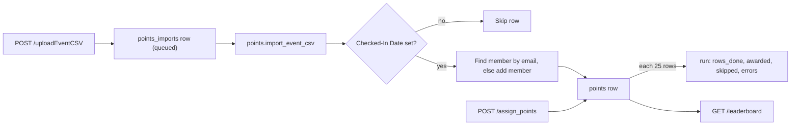

# Points

Keeps the points that an org's members earn at events. Officers add members, give points by hand or from an attendance CSV, and read the leaderboard. The `points` switch turns the module on and off.

## In the dashboard

The Points page (Storage > Points) has two tabs:

- **Members**: the leaderboard with each member's total. Search by name or email. Add a member, or give points to one member. Open a member to see the member drawer: the total, the points of the last 30 days and the entries by event. A store order and its refund show as one line, `held` while the order holds the points. Edit, Award and delete of one entry are in the drawer. `?member=<email or uuid>` opens it from a link.
- **Events**: the points given at each event. Upload an attendance CSV for an event, or delete the points of an event.

Totals change on every page that shows them (Points, the member drawer, Overview, Store, the member store) without a reload. An award in the dashboard moves the total at once. Points that an agent, the bot or a CSV import adds show within 15 seconds.

## Attendance CSV

Upload a CSV with an event name and the points for each person (a whole number). A background job reads it and adds the points in batches of 25 rows. The upload dialog shows the progress, then the counts and a table of the rows that failed, with the CSV row number and the email. Close the dialog and the Points page shows the progress while the import runs.

| Column | Use |
| --- | --- |
| `Email` | Required. The member's email. One award for each email |
| `First Name`, `Last Name` | Required. The name of a new member |
| `Checked-In Date` | Rows with no value get no points |

A person with no member record becomes a member of the org. A person who is a member of another org only also becomes a member of this org. A person with an inactive membership keeps it inactive.

## Routes

All routes are under `/api/points/<org>`.

| Route | Does |
| --- | --- |
| `GET /users`, `POST /users` | Lists the org's members; adds or updates a member |
| `PUT /users/<id>` | Changes a member's fields |
| `GET /users/<id>/points` | One member's point entries |
| `POST /assign_points` | Gives points to one member: `user_identifier`, `points`, `event` |
| `DELETE /delete_points` | Deletes a member's first entry for one event: `user_email`, `event` |
| `DELETE /entries/<id>` | Deletes one point entry of the org by its id. An entry of another org gets 404 |
| `POST /uploadEventCSV` | Form fields `file`, `event_name`, `event_points` (a whole number, else 400). Starts the CSV job and returns 202 with `import_id` |
| `GET /imports`, `GET /imports/<id>` | The newest 20 CSV import runs; one run with its progress, counts and row errors. A run of another org gets 404 |
| `GET /get_points` | Every point entry of the org |
| `GET /leaderboard` | The leaderboard. Open to everyone. Emails show only to a signed-in caller |
| `POST /member_login`, `GET /member_profile` | Member sign-in and profile for the member site |

Officers of the org can use every route except the leaderboard and member routes. `getUserPoints`, `getUserTotalPoints` and `add_points` are older names that SoDA's site still calls.

## For agents

The MCP tool `points.leaderboard` (scope `points:read`) returns the leaderboard. `points.entries` and `points.history` (scope `members:read`) return point entries. `points.imports` (scope `members:read`) returns the CSV import runs. `points.award`, `points.delete` (confirm) and `points.import_csv` (scope `points:write`) change them. `points.award` gives the same points to up to 100 members in one commit; if one is not a member, nothing changes.

## Tables

`points`: one row for each award, with the member, the event, the points and the officer. `points_imports`: one row for each CSV import run, the newest 50 for each org. Members and memberships are in the `users` module.
