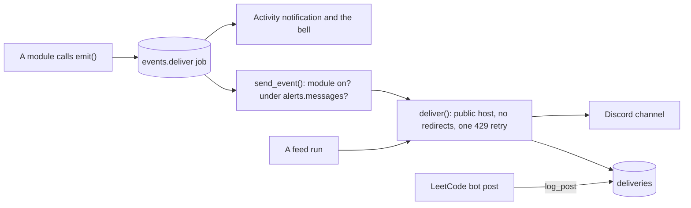

# Alerts

The Alerts module (`modules/alerts/`) sends a message to a channel when an event happens in an org. It is a Core module, so it is always on. Officers add destinations on the Alerts page. A destination is a Discord webhook with a name and the events it gets: its routes. Feeds post to a destination too.

Each event also shows on the Activity page and in the bell, also when no destination gets it. The hourly limit applies only to messages to destinations.

Every message goes through one send path, `deliver()` in `modules/alerts/delivery.py`, and gets one row in `deliveries`. When a post fails, look there first: the row has the source, the event or feed key and the error, and the log has a line `alert delivery failed org=... destination=... source=... ref=... error=...`.



The Alerts page has two cards. Destinations lists each destination with its state, a test and its last error. Routes lists each event and feed, and the destinations it goes to. An event with no destination shows "Activity only". Uptime decides what to watch; Alerts decides where its `monitor.down` and `monitor.up` events go.

## Events

| Key | Label | Sent by | Sent when |
| --- | --- | --- | --- |
| `errors` | Errors | `modules/dashboard/errors.py` | A new error group, or a resolved group that comes back. See [Health, logs and errors](./operations.md#health-logs-and-errors) |
| `job.failed` | Failed job runs | `core/jobs.py` | A job with an `org_id` or `org_prefix` argument fails. Jobs for the whole server do not send it |
| `pod.started` | Pods started | `modules/godfather/service.py`, `schedule.py` | An officer or a tool starts or restarts a pod, or the session schedule starts it |
| `pod.stopped` | Pods stopped | `modules/godfather/service.py`, `schedule.py` | An officer or a tool stops or terminates a pod, or the session schedule stops it |
| `pod.root_access` | Root on a pod | `modules/godfather/connections.py` | An officer gets a one-hour root certificate for a pod with pod admin on |
| `app.deployed` | App deploys | `hosting/deploys.py` | A deploy of an org's app, on RunPod or This server, becomes healthy or fails. A shared app has no org, so its deploys show only on the Shared apps page of the superadmin space |
| `order.created` | Store orders | `modules/points/submodules/store/service.py` | A member places an order |
| `member.joined` | New members | `modules/members/service.py` | A person joins the org at sign-in, through a form or a CSV import. A Discord member sync does not send it |
| `knowledge.crawl_failed` | Knowledge crawl failures | `modules/knowledge/runs.py` | A crawl of a knowledge source fails |
| `monitor.down` | Monitors down | `modules/uptime/service.py` | A monitor's first check is down, or a check is down after an up check. See [Uptime](./modules/uptime.md) |
| `monitor.up` | Monitors up | `modules/uptime/service.py` | A check is up after a down check |
| `asu.session_expired` | ASU sign-in expired | `modules/knowledge/submodules/asu_signin/service.py` | An `asu.*` tool finds that the saved ASU sign-in expired. Sent one time for each sign-in |
| `leetcode.post_failed` | LeetCode post failures | `modules/bot/submodules/leetcode/daily.py` | The bot cannot post the org's daily question. Sent once a day; the post is tried again every 5 minutes |

The page lists and sends an event only when its module is on for the org. Pods need `godfather`, orders need `storefront` and monitors need `uptime`. An event of a module that is off stays on the destination, so it is sent again when the module comes back. Uptime checks each Hosting app; `app.deployed` says only how a deploy ended.

## Delivery

- `emit()` returns at once. It queues the `events.deliver` job (`core/webhooks.py`). The job saves the notification, then `send_event()` posts to each enabled destination of the org that takes the event. A request never waits for a post. An `emit()` inside that job does nothing, so a failed delivery cannot send an event about itself.
- An org gets at most 30 messages in an hour for each event (limit `alerts.messages`). The count is in `usage_counters`, so every process shares it. More messages in that hour are dropped, with a log line.
- Each destination keeps the time and the error of its last message, also for feed posts. The page shows the error in red.
- "Send test" posts one message now and shows the result.
- A post has a timeout of 10 seconds, does not follow redirects, and connects only to a public address. On 429 it waits once for `retry_after`, at most 10 seconds. An error says the status code and Discord's reason. It never has the URL.
- Discord bodies leave out empty keys and fit Discord's embed limits (title 256, description 4096, 25 fields, 6000 in total).
- `deliveries` keeps 30 days (`alerts.prune`, daily).

## Destination kinds

Discord is the only kind now. A URL must match `https://discord.com/api/webhooks/<id>/<token>` and its host must resolve to public addresses (`core/net.py`). Platform encrypts the URL with `SECRETS_KEY` and never returns it. The page shows the host and the last 4 digits of the webhook id.

To add a kind, such as Slack, add a `Kind` to `KINDS` in `modules/alerts/delivery.py`: a URL pattern, an example, a function that turns a `Message` into the body, and a hint. The page reads the kinds from the API.

## Add an event

1. Declare it at the top of the module's `service.py` (or the file that sends it):

   ```python
   from core import webhooks

   webhooks.declare("thing.done", "Things done", "A thing ends.", "things")
   ```

   The last argument is the optional module that must be on for the org.
2. Send it where the event happens, after the commit:

   ```python
   webhooks.emit(org_id, "thing.done", webhooks.Message(title=f"Thing {name} done", color=webhooks.GREEN))
   ```

   `emit()` takes an org id or an org prefix. It never raises.
3. Add the event to the table on this page and to `webhookEvents` in `dashboard/scripts/fixtures.ts`.
4. Add a test in `tests/contract/test_webhooks.py`. The `sent` fixture keeps each post and returns 400 for a body Discord would refuse. Reading it waits for the queued `events.deliver` jobs; `sent.wait()` does that alone.

## Routes

All routes are under `/api/dashboard/<org>/webhooks`, for officers of the org. The path keeps the word webhooks: a destination is a row of the `webhooks` table.

| Route | Does |
| --- | --- |
| `GET /` | The destinations, the events and kinds to pick from, the feeds with their `destination_id`, and `secrets_key` |
| `POST /` | Adds a destination: `{"name", "kind": "discord", "url", "events": [...]}`. Returns 201 |
| `PUT /<id>` | Changes `name`, `url`, `events` or `enabled`. A missing key keeps its value |
| `DELETE /<id>` | Removes the destination. Returns 409 while a feed posts to it |
| `POST /<id>/test` | Posts a test message. Returns `{"ok", "message"}` |
| `GET /deliveries` | The log, newest first: `{"deliveries": [...], "next"}`. Query `source` (`event`, `feed`, `leetcode`, `test`), `destination_id`, `status` (`sent`, `failed`), `before` (the `next` of the last page) and `limit` (at most 100) |

## Feeds and the server webhook

- A feed posts to the Discord destination in its `destination_id`. Pick it in the new feed form on the Job alerts and Hackathons pages. A feed made before migration `c6e8a0b2d4f6` can still post to its own webhook secret `alert_webhook_<key>`. See [Feeds](./modules/feeds.md).
- `ERROR_WEBHOOK_URL` in `.env` gets every new error of every org and of the server, at most 30 an hour. It goes through `events.deliver` and `deliver()` too, with a log line and no `deliveries` row. It is not an org webhook and does not show on the page.
- The LeetCode daily post goes out through the bot, because the solve checks need its reaction. Each org post is logged in `deliveries` with a link to the message. The first failure of the day is logged too and sends `leetcode.post_failed`.

The `webhooks` and `deliveries` tables are in [Data model](./data-model.md). Migration `c6e8a0b2d4f6` made `alerts` from the `event_webhook` module; an org that had that switch off got its destinations turned off. Migration `a1358e0da9ef` moved each org secret `error_webhook_url` to a webhook named Errors that sends `errors`.
