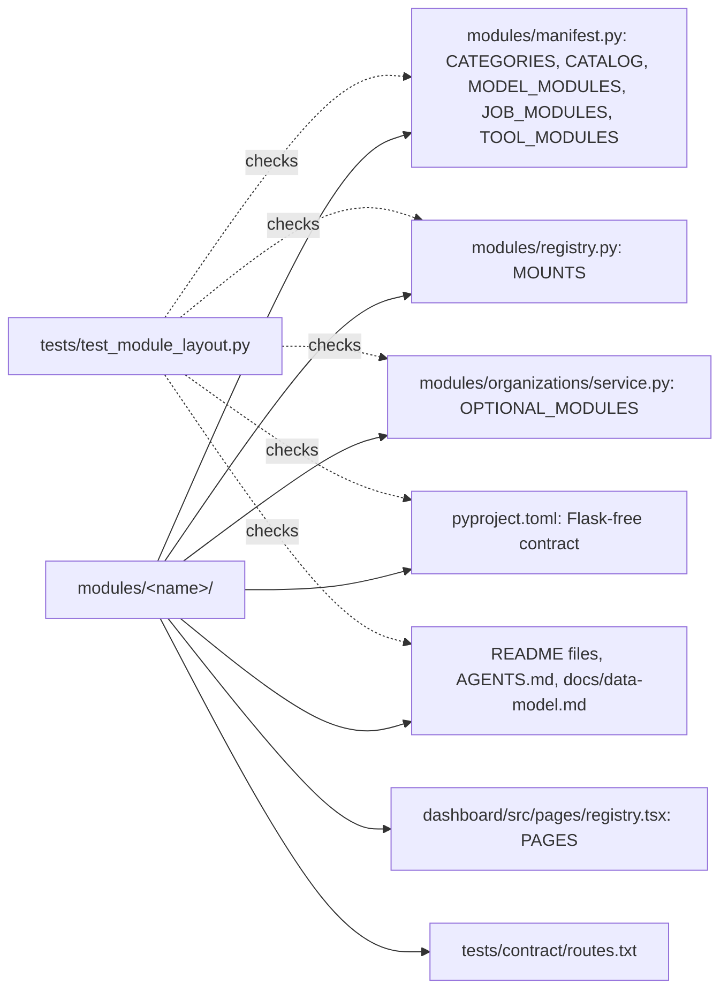

# Writing a module

This page lists the files a module can have, the places to register it, and the rules that `make ci` checks. The `new-module` skill in `.agents/skills/` has the full procedure. Content for one campus or topic, such as pages to crawl and live queries, is a shared sub-module: see [Shared sub-module](#shared-sub-module).

## Files

| File | Holds | Add it when |
| --- | --- | --- |
| `README.md` | What the module does, a Files table and a Surface list (routes, jobs, tools, tables). A Known gaps list if the module breaks a rule on this page | always |
| `service.py` | The logic. It takes a database session and plain values, returns plain values and raises a `ServiceError`. It does not import Flask | the module does more than read a table |
| `api.py` | A Flask blueprint. Each route reads the request, calls `service.py` and returns JSON | the module has routes |
| `models.py` | SQLAlchemy tables that use `Base` from `core/db/base.py`, with `Mapped[...]` columns from `mapped_column` | the module keeps data |
| `jobs.py` | Background work with `@job` from `core/jobs.py` | the module runs on a schedule or in the background |
| `tools.py` | Tools for agents with `@tool` from `core/tools.py`. Name each `<module>.<action>`, and add a row for each to `GUARDRAILS` in `core/tools.py` (writes, confirm, rate class). Agents reach them through `modules.tools` and `modules.call`, not the tool list | agents call the module |
| `SKILL.md` | For agents: frontmatter `name` (the tool name prefix) and `description`, then what the module is for, which tool to call when, and what to watch out for. `modules.skill` gives it to agents | the module has tools |

If `service.py` has more than one concern, split it into more Flask-free files. For example, `godfather/` has `ssh.py`, `files.py` and `schedule.py`.

## Register it

| What | Where |
| --- | --- |
| Category | `CATEGORIES` in `modules/manifest.py`. Put the module in one category. Core modules are always on and are not on Explore |
| Catalog entry | `CATALOG` in `modules/manifest.py`: the title and one-line description that Explore shows, and each integration key or setting the module needs (`Need`) |
| Blueprint and URL prefix | `MOUNTS` in `modules/registry.py`, and the import at the top of that file |
| Tables | `MODEL_MODULES` in `modules/manifest.py`, then `uv run alembic revision --autogenerate -m "..."` |
| Jobs | `JOB_MODULES` in `modules/manifest.py` |
| Tools | `TOOL_MODULES` in `modules/manifest.py` |
| Machine token scopes | `scopes.declare(...)` from `modules/auth/scopes.py`, at the top of `service.py` |
| Org secrets | `secrets.declare(...)` or `secrets.declare_prefix(...)` from `core/secrets.py`, at the top of `service.py` |
| Limits | `limits.declare(...)` from `core/limits.py`, at the top of `service.py`, for each thing that can grow or cost money. See [limits.md](./limits.md) |
| Outside services | `register(...)` and `use(...)` from `core/integrations/registry.py`. See [integrations.md](./integrations.md) |
| Flask-free files | `service.py`, `models.py`, `jobs.py` and `tools.py` are in the "service modules do not import Flask" contract in `pyproject.toml` by the `modules.**.<file>` wildcard, which also covers sub-modules. Add each other Flask-free file, such as `crawl.py`, to that list |
| Dashboard page | An entry in `PAGES` in `dashboard/src/pages/registry.tsx`, with `module` and the sidebar section of the module's category |
| Routes | `tests/contract/routes.txt`: run `UPDATE_ROUTES=1 uv run pytest tests/contract/test_routes.py` |
| Docs | The module `README.md`, a row under its category in `modules/README.md` and in the module table of `README.md`, the `Modules:` line in `AGENTS.md`, and each table in `docs/data-model.md` |

If the module needs more than its README, add `docs/modules/<name>.md`, a row in `docs/README.md`, and the page in `site/scripts/sync-docs.ts`.

`tests/test_module_layout.py` checks the categories, the catalog entries, the manifest lists, `MOUNTS`, the Flask-free contract, the module switches, the docs rows, and that each README and `docs/data-model.md` name the module's jobs, tools and tables. If you forget a place, the test names the file to change.

This diagram shows the places to register a module and the places that the test checks.



### Org switch

If orgs can turn the module off:

1. Add the name and a one-line description to `OPTIONAL_MODULES` in `modules/organizations/service.py`.
2. Set `module="<name>"` on the `Mount`. Its org routes then return 404 when the module is off. For one route in a shared blueprint, use `endpoint_modules`.
3. Set `module="<name>"` on each `@tool`. The tool then does not show for an org that turned it off.
4. In a job that runs for all orgs, skip an org when `organizations.module_enabled(org, "<name>")` is false.
5. Add the name to the expected dict in `tests/contract/test_modules.py`.
6. A new org starts with the module off. To start new orgs with it on, add it to `NEW_ORG_MODULES` in `modules/manifest.py`.

### Sub-module

A sub-module is a part of a module with its own switch, such as `points.store`. It is on only while its module is on. To add one:

1. Make the folder `modules/<module>/submodules/<name>/` with the files it needs, like a module.
2. In its `__init__.py`, set `SUBMODULE = Submodule("<module>", "<name>", "<Title>", "<one line>")` from `core/submodules.py`. Give `on_enable` to run code when an org turns it on.
3. Add the name to `SUBMODULES["<module>"]` in `modules/manifest.py`, and list its `models.py`, `jobs.py` and `tools.py` there by their full path.
4. Use the key `<module>.<name>` in `module=` on the `Mount` or `endpoint_modules`, on each `@tool`, and in `module_enabled`.
5. Add a `README.md` and a row in `modules/README.md`. A sub-module with no entry in an org's switches is off, so a migration that adds one to existing orgs sets the key.

### Shared sub-module

A shared sub-module holds content that the deployment makes once for every org that has it on, such as `knowledge.asu` (pages and live queries) or `feeds.jobs` (feed presets). It holds content and settings, not new behavior.

1. Make the sub-module as above, with `shared=True` on its `Submodule`. Its switch and the org's row in `submodule_subscriptions` go together: `set_modules` adds or deletes the row in the same commit, checks the `submodules.subscriptions` limit, and then runs `on_enable`.
2. For knowledge, add `content.py` with `CONTENT`, a `Content` from `modules/knowledge/content/types.py`:

   ```python
   from modules.knowledge.content.types import Content, QueryParam, QuerySource, Source

   CONTENT = Content(
       name="example",
       sources=(
           Source(key="library_hours", url="https://lib.example.edu/hours", category="library", fetch_every_hours=24),
       ),
       queries=(
           QuerySource(
               key="events",
               description="Campus events that match keywords.",
               params=(QueryParam("keywords", "Words to search for."),),
               to_url=lambda p: "https://events.example.edu/search?q=" + p.get("keywords", ""),
           ),
       ),
       timezone="America/Los_Angeles",
   )
   ```

   The name is lowercase letters, digits and underscores. The content owns the shared sources with keys that start with `<name>/`, and the org's live results under `<name>-live/`. Give `on_enable` that syncs the shared pages and starts the crawl, as `modules/knowledge/submodules/asu/__init__.py` does.
3. The `search` tool fills a query's parameters from one plain query: the first text parameter takes the words, a parameter with `choices` takes the choices the words name, and a `QueryParam` with `date=True` takes a YYYY-MM-DD in the words, else today when it is required. A query sets `query_param` to fill another text parameter, `narrow` to cut the words its site cannot match, and `derive` for values the words imply, like the term of a class search. See `modules/knowledge/submodules/asu/params.py`.
4. Give a `Source` or `QuerySource` an `extractor` that turns the fetched page into one line for each record. Helpers are in `modules/knowledge/content/text.py`. A query that calls an API sets `answer` instead of `to_url`. Add `modules.knowledge.submodules.web.query` to `queries` for web search.
5. For feeds, set `FEEDS` in `__init__.py`: a tuple of `Feed` from `modules/feeds/types.py`, each with a key (lowercase letters, digits and dashes), a title, a description, and the `kind` and `config` that the [feeds module](./modules/feeds.md) takes. Add the kind to `KIND_MODULES` in `modules/feeds/service.py`.
6. Platform makes the sub-module's row in the `submodules` table the first time an org turns it on (`row_for` in `core/submodules.py`). A migration is needed only to turn it on for existing orgs.
7. Add tests in `tests/contract/` with saved pages in a fixtures folder. Do not fetch live pages in tests.

Rules:

- Public pages only. Do not add pages that need a sign-in. `knowledge.asu_signin` is the one exception: it has its own switch, routes in the dashboard module and an org secret, and its results are never indexed.
- Do not change a source key after orgs use it. A new key makes a new source, and the old one is turned off on the next sync.

`hosting/` is a layer, not a module: it is next to `modules/`, in no category, and `LAYERS` in `modules/manifest.py` lists it.

## Routes

Use the helpers in `modules/auth/routes.py`. Each one checks the caller, opens a database session, finds the org and changes a `ServiceError` into `{"error": message}` with its status.

| Helper | Use it for | The view gets |
| --- | --- | --- |
| `officer_route(blueprint, rule, methods)` | Officer routes under `/<org_prefix>` | `db, org, **path args` |
| `machine_route(blueprint, rule, scope, methods)` | Routes for apps and agents with a machine token | `db, org, **path args` |
| `member_view(view)` | Routes for members signed in with Discord | `db, org, discord_id, **path args` |

```python
from functools import partial

from flask import Blueprint

from core.http.responses import json_body
from modules.auth.routes import machine_route

from . import service

things_blueprint = Blueprint("things", __name__)
_route = partial(machine_route, things_blueprint)


@_route("/things/<string:key>", "things:write", ["PUT"])
def put_thing(db, org, key):
    return service.put_thing(db, int(org.id), key, json_body()), 201
```

A view returns a dict, or a `(dict, status)` tuple. For other routes, use the decorators in `modules/auth/decorators.py`. See [Authentication](./authentication.md).

## Errors

A module has one error class, a subclass of `core.errors.ServiceError`:

```python
class ThingError(ServiceError):
    pass


raise ThingError("No thing with that key", 404)
```

The route helpers and the tool runner return its message and status. A tool function thus calls the service and needs no `try`.

## Rules that `make ci` checks

- `core/` imports nothing from `modules/` (import-linter).
- The files in the Flask-free contract do not import Flask (import-linter).
- ruff lint and format, and the ty type check. CI also runs bandit.
- `tests/contract/routes.txt` agrees with the routes of the app.
- `tests/contract/` checks each route that a client uses. Add a test there for a new route.
- `alembic check` finds no model change without a migration.
- `tests/test_module_layout.py` finds each module in every place listed in [Register it](#register-it).

## Example

`modules/feeds/` is a small module with `service.py`, `api.py` on `officer_route`, `models.py`, `jobs.py` and `tools.py`. `hosting/api.py` is the example for `machine_route`.
