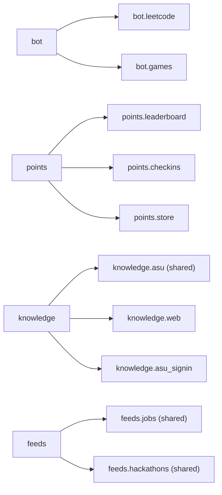

# Modules

One folder for each module. Each folder has a `README.md` with its files and its surface: routes, jobs, tools and tables. [docs/writing-a-module.md](../docs/writing-a-module.md) gives the rules and the places to register a new module.

`CATEGORIES` in `manifest.py` groups the modules below in the same sections as the Explore page and the sidebar of the dashboard. Each module is in one category. `CATALOG` in `manifest.py` gives the title, description and needs that the page shows for each module. A new org starts with every switch in the Org switch column off.

A module can have sub-modules: parts with their own switch, in `modules/<module>/submodules/<name>/`. Each sets `SUBMODULE` in its `__init__.py` (`core/submodules.py`), and `SUBMODULES` in `manifest.py` lists them. The switch key is `<module>.<name>`, and a sub-module is on only when its module is on too. A shared sub-module (`shared=True`), such as `knowledge.asu`, holds content made once for every org; its switch is the org's subscription row in `core/submodules.py`.

## Core

Core modules are always on. The Explore page of the dashboard does not show them.

| Module | Does | Org switch |
| --- | --- | --- |
| [alerts](alerts/README.md) | The org's events, such as a failed job, sent to its destinations (Discord webhooks). Feeds post to a destination too | |
| [auth](auth/README.md) | Discord sign-in, tokens, access checks, machine tokens and scopes | |
| [bot](bot/README.md) | The Discord bot and its helper cog. Its sub-modules are in Discord | |
| [dashboard](dashboard/README.md) | Overview, branding, CI runs and the module catalog for the officer dashboard | |
| [mcp](mcp/README.md) | The MCP server and `/api/tools`. A token's scopes decide what an agent can call | |
| [members](members/README.md) | Members and memberships | |
| [organizations](organizations/README.md) | Orgs, config, module switches, secrets and machine tokens | |
| [public](public/README.md) | Open reads | |
| [superadmin](superadmin/README.md) | Orgs, limits, the server's services and the shared apps, for the whole deployment | |

## Members

| Module | Does | Org switch |
| --- | --- | --- |
| [points](points/README.md) | Points and the member list with points | `points` |
| [points.leaderboard](points/submodules/leaderboard/README.md) | The leaderboards | `points.leaderboard` |
| [points.checkins](points/submodules/checkins/README.md) | Attendance CSV imports | `points.checkins` |
| [points.store](points/submodules/store/README.md) | Merch store paid in points | `points.store` |

## AI

| Module | Does | Org switch |
| --- | --- | --- |
| [knowledge](knowledge/README.md) | Sources, crawls and hybrid search | `knowledge` |
| [knowledge.asu](knowledge/submodules/asu/README.md) | Shared ASU pages and live queries | `knowledge.asu` |
| [knowledge.web](knowledge/submodules/web/README.md) | Web search through SearXNG | `knowledge.web` |
| [knowledge.asu_signin](knowledge/submodules/asu_signin/README.md) | An officer's ASU sign-in for Sun Devil Central | `knowledge.asu_signin` |
| [integrations](integrations/README.md) | Tools of connected services (GitHub) passed through to their MCP servers | `integrations` |

## Automations

| Module | Does | Org switch |
| --- | --- | --- |
| [feeds](feeds/README.md) | New job listings and hackathons posted to an alert destination | `feeds` |
| [feeds.jobs](feeds/submodules/jobs/README.md) | Internship and new grad feeds from GitHub job lists | `feeds.jobs` |
| [feeds.hackathons](feeds/submodules/hackathons/README.md) | Hackathon feeds | `feeds.hackathons` |
| [calendar](calendar/README.md) | Notion events synced to Google Calendar | `calendar` |
| [uptime](uptime/README.md) | Checks of sites and Hosting apps, with events when one goes down or up | `uptime` |

## Discord

Sub-modules of bot, which is Core.

| Module | Does | Org switch |
| --- | --- | --- |
| [bot.leetcode](bot/submodules/leetcode/README.md) | The daily LeetCode post and solve checks | `bot.leetcode` |
| [bot.games](bot/submodules/games/README.md) | Jeopardy in Discord | `bot.games` |

## Compute

| Module | Does | Org switch |
| --- | --- | --- |
| [godfather](godfather/README.md) | Pods on a hosting provider (RunPod) that members connect to with the Godfather CLI | `godfather` |

## Apps

[hosting](../hosting/README.md) is not a module. It is the apps layer next to `modules/`: deploys of the org's own apps to RunPod or This server, and shared apps. `LAYERS` in `manifest.py` gives its card, and its switch is `hosting`.

## Shared files

`registry.py` mounts each blueprint. `manifest.py` lists the categories, the sub-modules, the layers and the model, job and tool modules. `cli.py` has the `flask --app main org`, `jobs` and `config` commands. `tests/test_module_layout.py` checks that each module is in these lists and in the docs.

The modules from SoDA (points, the store, members, superadmin, calendar, organizations, public, auth, games) do not follow the module pattern in full. Each README lists its Known gaps.
