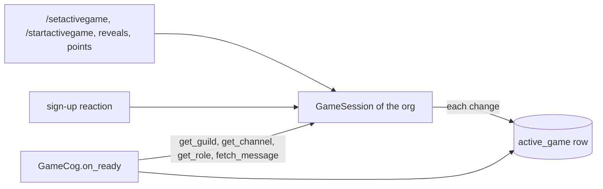

# bot.games

A sub-module of `bot`, switch `bot.games`. Runs Jeopardy games in an org's Discord server. Officers upload games, select the active one and run it with the bot commands. `GameCog` makes the team roles and channels, posts questions and keeps the scoreboard.

## Files

| File | Holds |
| --- | --- |
| `api.py` | Game controls: upload, list, set and start the active game, show questions and answers, give team points |
| `service.py` | The game JSON check, the stored games of an org (`list_games`, `get_game`, `save_game`), the org of a request (`game_org`), the `active_game` rows, and reads of a game file from `./data` |
| `cog.py` | `GameCog`: one `GameSession` for each Discord server. `on_ready` builds them again from `active_game` |
| `session.py` | `GameSession`: the game of one org with its channels, roles, sign-up, questions and scoreboard. Each change writes the org's `active_game` row |
| `ui.py` | The Discord view of a question post |
| `jeopardy/` | `JeopardyGame`, `JeopardyQuestion`, `Team` |
| `models.py` | `jeopardy_game` (the stored games of each org) and `active_game` (the set-up game of each org) |

## Surface

- Routes: `/api/bot`. Each route needs an officer of an org that has the `bot.games` switch on. For another officer, each route returns 404. The routes that run a game need the bot in the API process (`current_app.auth_bot`), so they fail under gunicorn.
- The org of a request: the one org of the caller with `bot.games` on. An officer of more than one such org sets `org` (the prefix) or `guild_id`. The superadmin must set one of them. An officer cannot name an org where they are not an officer (400).
- Jobs: none.
- Tools: none.
- Flow: `POST /setactivegame?name=...` sets the org's game and makes its channels, roles and announcement in the org's Discord server. Members enroll with a reaction. `POST /startactivegame` puts each member in one team and starts the game. While a game is set up, `/setactivegame` returns 409 until `/cleanactivegame` removes it. Each org has its own game, so two orgs can run games at the same time.
- Tables: `jeopardy_game` (unique `organization_id`, `name`), `active_game` (one row for each org with a set-up game).

## State across a restart

`active_game.game_data` is `JeopardyGame.to_json()`. `helper_data` holds the ids of the category, stage, team roles, voice channels, announcement and scoreboard channels, the sign-up, scoreboard, gameboard and question posts, the players and teams, and the date and time. After a restart, `GameCog.on_ready` builds each session from its row. A channel, role, message or member that is gone is dropped and logged (`game restore dropped missing Discord objects`). The sign-up listener of `HelperCog` and the buzz-in buttons of open questions come back too. A row whose server the bot is not in is kept and skipped.

## Known gaps

- The routes need the bot in the API process, so the AIS deployment turns them off with `DISABLED_ROUTES`.
